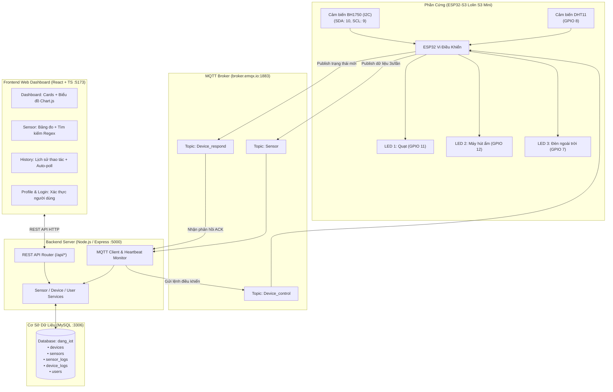

# 🏡 SMART HOME IoT MONITORING & CONTROL SYSTEM — BÀI THỰC HÀNH 3
*(Mạch ESP32-S3 / Lolin S3 Mini — Node.js Backend — React Web Dashboard — MySQL Database)*

<div align="center">

[](https://www.espressif.com/)
[](https://nodejs.org/)
[](https://react.dev/)
[](https://www.mysql.com/)
[](https://www.emqx.io/)
[](https://tailwindcss.com/)

</div>

---

## 👨‍🎓 Thông Tin Sinh Viên & Đề Tài

* **Họ và tên:** Đặng Trần Hải Đăng
* **Mã số sinh viên (MSSV):** B23DCAT036
* **Lớp hành chính:** D23CQAT01-B
* **Khoa đào tạo:** An Toàn Thông Tin (ATTT)
* **Giảng viên hướng dẫn:** TS. Nguyễn Quốc Uy
* **Cơ sở đào tạo:** Học viện Công nghệ Bưu chính Viễn thông (PTIT Hà Nội)
* **Học phần:** Thực hành Internet of Things (IoT)

---

## 📖 Giới Thiệu Dự Án

Hệ thống **Smart Home IoT Monitoring & Control System** là giải pháp giám sát môi trường và điều khiển thiết bị thông minh toàn diện, tích hợp chặt chẽ giữa 3 tầng công nghệ:
1. **Tầng Phần Cứng (Hardware Layer):** Vi điều khiển **ESP32-S3 (Lolin S3 Mini)** giao tiếp với cảm biến nhiệt độ - độ ẩm `DHT11`, cảm biến cường độ ánh sáng số `BH1750` qua chuẩn I2C, và điều khiển 3 cơ cấu chấp hành (Quạt, Máy hút ẩm, Đèn ngoài trời).
2. **Tầng Dịch Vụ Máy Chủ (Backend Layer):** Máy chủ **Node.js / Express** đóng vai trò cầu nối thông minh giữa giao thức **MQTT** (`broker.emqx.io:1883`) và cơ sở dữ liệu quan hệ **MySQL** (`dang_iot`), đồng thời cung cấp hệ thống REST API chuẩn hóa cho ứng dụng phía người dùng.
3. **Tầng Giao Diện Người Dùng (Frontend Layer):** Ứng dụng Web **React 19 + TypeScript + Vite + Tailwind CSS** với giao diện hiện đại, trực quan, hỗ trợ vẽ biểu đồ đường đa trục theo chuỗi thời gian thực, bảng nhật ký phân trang động và tìm kiếm dữ liệu nâng cao.

---

## 📁 Cấu Trúc Thư Mục Dự Án

Dự án được tổ chức tách biệt, rõ ràng theo chuẩn module hóa:

```text
BaiThucHanh3/
├── PhanCung/                                # MÃ NGUỒN PHẦN CỨNG ESP32 (PLATFORMIO)
│   ├── platformio.ini                       # Cấu hình board Lolin S3 Mini và các thư viện
│   └── src/
│       ├── main.cpp                         # Mã nguồn C++ xử lý đọc cảm biến, WiFi, MQTT
│       └── secrets.h                        # Khai báo thông số mạng và xác thực MQTT
│
└── PhanMem/                                 # MÃ NGUỒN PHẦN MỀM HỆ THỐNG
    ├── BE/                                  # BACKEND REST API & MQTT-TO-MYSQL BRIDGE
    │   ├── config/
    │   │   ├── mqtt.js                      # Cấu hình kết nối MQTT Broker và định nghĩa Topics
    │   │   └── mysql.js                     # Quản lý MySQL Connection Pool (mysql2/promise)
    │   ├── handlers/
    │   │   └── mqttHandler.js               # Xử lý nhận tin MQTT, Heartbeat và ACK thiết bị
    │   ├── routes/
    │   │   └── api.js                       # Định nghĩa các REST API Endpoints
    │   ├── services/
    │   │   ├── mysqlDeviceService.js        # Nghiệp vụ thiết bị và nhật ký điều khiển
    │   │   ├── mysqlSensorService.js        # Nghiệp vụ cảm biến và bộ đệm số liệu
    │   │   └── mysqlUserService.js          # Nghiệp vụ hồ sơ sinh viên và xác thực Login
    │   ├── utils/
    │   │   └── dateHelper.js                # Xử lý bộ lọc khoảng thời gian SQL
    │   ├── .env                             # Biến môi trường (DB Host, Port, MQTT Broker)
    │   ├── .env.example                     # Bản mẫu biến môi trường
    │   ├── index.js                         # Điểm khởi chạy chính máy chủ Express (Port 5000)
    │   └── package.json                     # Danh sách phụ thuộc Backend
    │
    └── FE/                                  # FRONTEND WEB DASHBOARD (REACT + TS + VITE)
        ├── public/                          # Tài nguyên tĩnh (ảnh đại diện anhthe.png, truong.png)
        ├── src/
        │   ├── components/                  # Thành phần giao diện dùng chung
        │   │   └── Common/                  # Button, Card, Table, Pagination, Toast, Loading
        │   ├── contexts/
        │   │   └── AppContext.tsx           # Context quản lý State toàn cục & đồng bộ dữ liệu
        │   ├── layouts/
        │   │   ├── MainLayout.tsx           # Bố cục khung sườn giao diện chính
        │   │   ├── Navbar.tsx               # Thanh điều hướng trên, cờ ESP32 Online & đồng hồ
        │   │   └── Sidebar.tsx              # Menu chuyển trang và nút Đăng xuất
        │   ├── pages/
        │   │   ├── Dashboard.tsx            # Trang chủ: Thẻ đo, công tắc thiết bị, biểu đồ Chart.js
        │   │   ├── Sensor.tsx               # Trang nhật ký cảm biến, tìm kiếm Regex & phân trang
        │   │   ├── History.tsx              # Trang lịch sử bật/tắt thiết bị & bộ lọc 4 tiêu chí
        │   │   ├── Profile.tsx              # Trang hồ sơ sinh viên PTIT & liên kết dự án
        │   │   └── Login.tsx                # Trang xác thực đăng nhập bảo mật
        │   ├── services/api/
        │   │   └── apiService.ts            # Tầng giao tiếp HTTP REST API tới Backend
        │   ├── types/
        │   │   └── index.ts                 # Định nghĩa TypeScript Interfaces toàn hệ thống
        │   ├── utils/
        │   │   └── date.ts                  # Tiện ích định dạng ngày giờ chuẩn YYYY-MM-DD HH:mm:ss
        │   ├── App.tsx                      # Cấu hình Routes và Router Guard
        │   ├── main.tsx                     # Điểm gắn kết React DOM
        │   └── index.css                    # Cấu hình Tailwind CSS, animation và glow effects
        ├── index.html                       # HTML gốc của ứng dụng Web
        ├── package.json                     # Danh mục dependencies Frontend
        ├── tsconfig.json                    # Cấu hình TypeScript compiler
        └── vite.config.ts                   # Cấu hình đóng gói Vite
```

---

## 🏛️ Kiến Trúc Hệ Thống (System Architecture)



---

## 📡 Đặc Tả Giao Thức MQTT & Topics

Hệ thống sử dụng MQTT Broker công cộng **`broker.emqx.io`** trên cổng **`1883`** (TCP) với **3 Topic cốt lõi**:

### 1. `Sensor` (Dữ liệu đo đạc cảm biến)
* **Hướng truyền:** `ESP32` $\rightarrow$ `MQTT Broker` $\rightarrow$ `Backend`
* **Chu kỳ phát:** Định kỳ mỗi **3000 ms (3 giây)**.
* **Cấu trúc gói tin JSON:**
  ```json
  {
    "temperature": 28.5,
    "humidity": 65.0,
    "light": 480.0
  }
  ```
* **Chức năng:** Truyền số đo môi trường tức thời vào bộ đệm và lưu trữ vào bảng `sensor_logs`. Gói tin này đồng thời đóng vai trò **Heartbeat**; nếu Backend không nhận được gói tin trong quá **8 giây**, hệ thống tự động xác định trạng thái phần cứng chuyển sang `ESP32 Offline`.

### 2. `Device_control` (Lệnh điều khiển thiết bị)
* **Hướng truyền:** `Backend / Web Dashboard` $\rightarrow$ `MQTT Broker` $\rightarrow$ `ESP32`
* **Cấu trúc gói tin JSON:**
  ```json
  {
    "LED1": "ON"
  }
  ```
  *(Có thể truyền điều khiển riêng lẻ từng thiết bị hoặc đồng thời nhiều thiết bị, ví dụ: `{"LED1":"ON", "LED2":"OFF"}`).*

### 3. `Device_respond` (Xác nhận trạng thái vật lý thực tế)
* **Hướng truyền:** `ESP32` $\rightarrow$ `MQTT Broker` $\rightarrow$ `Backend`
* **Cờ cấu hình:** `retain = true` (Giúp các client mới kết nối ngay lập tức nắm bắt được trạng thái mạch).
* **Cấu trúc gói tin JSON:**
  ```json
  {
    "LED1": "ON",
    "LED2": "OFF",
    "LED3": "OFF"
  }
  ```
* **Chức năng:** Sau khi ESP32 thực thi lệnh gạt chân GPIO tương ứng, nó lập tức gửi gói tin xác nhận này. Backend bắt được tin sẽ ghi nhận thời điểm hoàn thành vào cột `thoi_gian_phan_hoi` trong bảng `device_logs`, xác nhận kết quả `SUCCESS`.

### 4. Lệnh kiểm thử nhanh bằng Mosquitto CLI

* **Lắng nghe dữ liệu cảm biến:**
  ```bash
  mosquitto_sub -h broker.emqx.io -p 1883 -t "Sensor" -v
  ```
* **Lắng nghe phản hồi trạng thái thiết bị:**
  ```bash
  mosquitto_sub -h broker.emqx.io -p 1883 -t "Device_respond" -v
  ```
* **Bắn lệnh bật Quạt (LED1):**
  ```bash
  mosquitto_pub -h broker.emqx.io -p 1883 -t "Device_control" -m "{\"LED1\":\"ON\"}"
  ```
* **Bắn lệnh tắt Quạt (LED1):**
  ```bash
  mosquitto_pub -h broker.emqx.io -p 1883 -t "Device_control" -m "{\"LED1\":\"OFF\"}"
  ```

---

## 🛠️ Hướng Dẫn Cài Đặt & Khởi Chạy

### Yêu cầu tiên quyết
* **Node.js:** Phiên bản $\ge$ 18.0.0
* **MySQL Server:** Đang chạy tại `localhost:3306` (đã có cơ sở dữ liệu `dang_iot`)
* **VS Code & PlatformIO IDE:** (Nếu cần nạp mã nguồn xuống mạch ESP32)

---

### Bước 1: Khởi động Backend Máy Chủ

1. Mở cửa sổ Terminal, di chuyển vào thư mục Backend:
   ```powershell
   cd BaiThucHanh3\PhanMem\BE
   ```
2. Khởi chạy máy chủ:
   ```powershell
   npm start
   ```
3. Khi khởi động thành công, màn hình sẽ hiển thị:
   ```text
   ==================================================
   🚀 SMART HOME BACKEND SERVER READY
   🌐 REST API Server : http://localhost:5000/api
   🗄️ MySQL Database  : Connected (dang_iot)
   ☁️ MQTT Broker     : broker.emqx.io:1883
   ==================================================
   ```

---

### Bước 2: Khởi động Giao Diện Frontend Web

1. Mở một cửa sổ Terminal mới, di chuyển vào thư mục Frontend:
   ```powershell
   cd BaiThucHanh3\PhanMem\FE
   ```
2. Khởi chạy máy chủ phát triển Vite:
   ```powershell
   npm run dev
   ```
3. Mở trình duyệt web và truy cập địa chỉ:
   ```text
   http://localhost:5173
   ```
4. **Thông tin đăng nhập mặc định:**
   * **Tên đăng nhập:** `ADMIN`
   * **Mật khẩu:** `123456`

---

### Bước 3: Nạp Code Phần Cứng Cho ESP32 (Tùy chọn)

1. Mở thư mục `BaiThucHanh3\PhanCung` bằng **Visual Studio Code**.
2. Kiểm tra thông số WiFi trong tệp `src/main.cpp` (SSID: `HaiDang`).
3. Kết nối mạch **Lolin S3 Mini** với máy tính qua cổng Type-C.
4. Nhấn biểu tượng **PlatformIO: Upload** trên thanh trạng thái phía dưới để nạp chương trình.
5. Mở **Serial Monitor** với tốc độ Baud `115200` để theo dõi các bản tin log đọc cảm biến và nhận lệnh MQTT.

---

## 🏆 Đánh Giá Kết Quả Thực Nghiệm

* [x] **Xóa sạch mock data:** Tệp `mockData.ts` và toàn bộ dữ liệu giả lập đã được loại bỏ hoàn toàn khỏi mã nguồn.
* [x] **Biên dịch Frontend hoàn hảo:** `npm run build` chạy thành công không có bất kỳ cảnh báo hoặc lỗi TypeScript nào.
* [x] **Dữ liệu thật 100%:** Toàn bộ thẻ thông số, biểu đồ phân tích, bảng dữ liệu cảm biến (hơn 26.600 dòng) và lịch sử thao tác đều được truy vấn trực tiếp từ MySQL `dang_iot`.
* [x] **Điều khiển 2 chiều:** Bật/tắt công tắc trên Web phát lệnh qua REST API $\rightarrow$ MQTT $\rightarrow$ ESP32 gạt chân GPIO $\rightarrow$ Gửi phản hồi ACK $\rightarrow$ Ghi nhận thời gian đáp ứng thực tế.
* [x] **Cấu trúc thư mục chuẩn hóa:** Chia tách rành mạch thành `PhanCung`, `PhanMem/BE` và `PhanMem/FE`.
