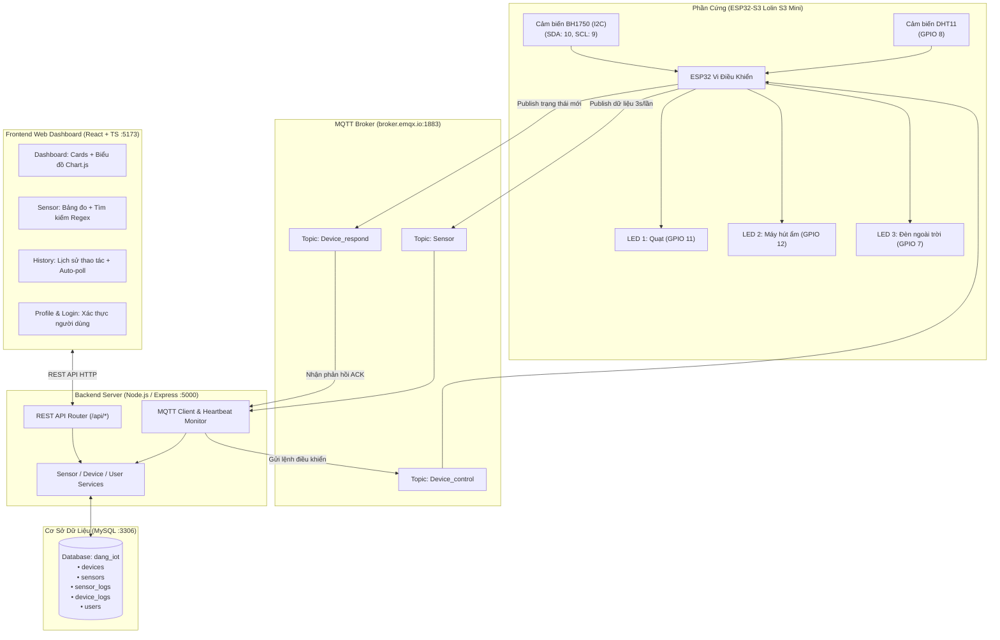

# 🏡 SMART HOME IoT MONITORING & CONTROL SYSTEM — BÀI THỰC HÀNH 3
*(Mạch ESP32-S3 / Lolin S3 Mini — Node.js Backend — React Web Dashboard — MySQL Database)*

<div align="center">

[](https://www.espressif.com/)
[](https://nodejs.org/)
[](https://react.dev/)
[](https://www.mysql.com/)
[](https://www.emqx.io/)
[](https://tailwindcss.com/)

</div>

---

## 👨‍🎓 Thông Tin Sinh Viên & Đề Tài

* **Họ và tên:** Đặng Trần Hải Đăng
* **Mã số sinh viên (MSSV):** B23DCAT036
* **Lớp hành chính:** D23CQAT01-B
* **Khoa đào tạo:** An Toàn Thông Tin (ATTT)
* **Giảng viên hướng dẫn:** TS. Nguyễn Quốc Uy
* **Cơ sở đào tạo:** Học viện Công nghệ Bưu chính Viễn thông (PTIT Hà Nội)
* **Học phần:** Thực hành Internet of Things (IoT)

---

## 📖 Giới Thiệu Dự Án

Hệ thống **Smart Home IoT Monitoring & Control System** là giải pháp giám sát môi trường và điều khiển thiết bị thông minh toàn diện, tích hợp chặt chẽ giữa 3 tầng công nghệ:
1. **Tầng Phần Cứng (Hardware Layer):** Vi điều khiển **ESP32-S3 (Lolin S3 Mini)** giao tiếp với cảm biến nhiệt độ - độ ẩm `DHT11`, cảm biến cường độ ánh sáng số `BH1750` qua chuẩn I2C, và điều khiển 3 cơ cấu chấp hành (Quạt, Máy hút ẩm, Đèn ngoài trời).
2. **Tầng Dịch Vụ Máy Chủ (Backend Layer):** Máy chủ **Node.js / Express** đóng vai trò cầu nối thông minh giữa giao thức **MQTT** (`broker.emqx.io:1883`) và cơ sở dữ liệu quan hệ **MySQL** (`dang_iot`), đồng thời cung cấp hệ thống REST API chuẩn hóa cho ứng dụng phía người dùng.
3. **Tầng Giao Diện Người Dùng (Frontend Layer):** Ứng dụng Web **React 19 + TypeScript + Vite + Tailwind CSS** với giao diện hiện đại, trực quan, hỗ trợ vẽ biểu đồ đường đa trục theo chuỗi thời gian thực, bảng nhật ký phân trang động và tìm kiếm dữ liệu nâng cao.

---

## 📁 Cấu Trúc Thư Mục Dự Án

Dự án được tổ chức tách biệt, rõ ràng theo chuẩn module hóa:

```text
BaiThucHanh3/
├── database_setup.sql                       # Tệp kịch bản khởi tạo cơ sở dữ liệu MySQL
├── PhanCung/                                # MÃ NGUỒN PHẦN CỨNG ESP32 (PLATFORMIO)
│   ├── platformio.ini                       # Cấu hình board Lolin S3 Mini và các thư viện
│   └── src/
│       ├── main.cpp                         # Mã nguồn C++ xử lý đọc cảm biến, WiFi, MQTT
│       └── secrets.h                        # Khai báo thông số mạng và xác thực MQTT
│
└── PhanMem/                                 # MÃ NGUỒN PHẦN MỀM HỆ THỐNG
    ├── BE/                                  # BACKEND REST API & MQTT-TO-MYSQL BRIDGE
    │   ├── config/
    │   │   ├── mqtt.js                      # Cấu hình kết nối MQTT Broker và định nghĩa Topics
    │   │   └── mysql.js                     # Quản lý MySQL Connection Pool (mysql2/promise)
    │   ├── handlers/
    │   │   └── mqttHandler.js               # Xử lý nhận tin MQTT, Heartbeat và ACK thiết bị
    │   ├── routes/
    │   │   └── api.js                       # Định nghĩa các REST API Endpoints
    │   ├── services/
    │   │   ├── mysqlDeviceService.js        # Nghiệp vụ thiết bị và nhật ký điều khiển
    │   │   ├── mysqlSensorService.js        # Nghiệp vụ cảm biến và bộ đệm số liệu
    │   │   └── mysqlUserService.js          # Nghiệp vụ hồ sơ sinh viên và xác thực Login
    │   ├── utils/
    │   │   └── dateHelper.js                # Xử lý bộ lọc khoảng thời gian SQL
    │   ├── .env                             # Biến môi trường (DB Host, Port, MQTT Broker)
    │   ├── .env.example                     # Bản mẫu biến môi trường
    │   ├── index.js                         # Điểm khởi chạy chính máy chủ Express (Port 5000)
    │   └── package.json                     # Danh sách phụ thuộc Backend
    │
    └── FE/                                  # FRONTEND WEB DASHBOARD (REACT + TS + VITE)
        ├── public/                          # Tài nguyên tĩnh (ảnh đại diện anhthe.png, truong.png)
        ├── src/
        │   ├── components/                  # Thành phần giao diện dùng chung
        │   │   └── Common/                  # Button, Card, Table, Pagination, Toast, Loading
        │   ├── contexts/
        │   │   └── AppContext.tsx           # Context quản lý State toàn cục & đồng bộ dữ liệu
        │   ├── layouts/
        │   │   ├── MainLayout.tsx           # Bố cục khung sườn giao diện chính
        │   │   ├── Navbar.tsx               # Thanh điều hướng trên, cờ ESP32 Online & đồng hồ
        │   │   └── Sidebar.tsx              # Menu chuyển trang và nút Đăng xuất
        │   ├── pages/
        │   │   ├── Dashboard.tsx            # Trang chủ: Thẻ đo, công tắc thiết bị, biểu đồ Chart.js
        │   │   ├── Sensor.tsx               # Trang nhật ký cảm biến, tìm kiếm Regex & phân trang
        │   │   ├── History.tsx              # Trang lịch sử bật/tắt thiết bị & bộ lọc 4 tiêu chí
        │   │   ├── Profile.tsx              # Trang hồ sơ sinh viên PTIT & liên kết dự án
        │   │   └── Login.tsx                # Trang xác thực đăng nhập bảo mật
        │   ├── services/api/
        │   │   └── apiService.ts            # Tầng giao tiếp HTTP REST API tới Backend
        │   ├── types/
        │   │   └── index.ts                 # Định nghĩa TypeScript Interfaces toàn hệ thống
        │   ├── utils/
        │   │   └── date.ts                  # Tiện ích định dạng ngày giờ chuẩn YYYY-MM-DD HH:mm:ss
        │   ├── App.tsx                      # Cấu hình Routes và Router Guard
        │   ├── main.tsx                     # Điểm gắn kết React DOM
        │   └── index.css                    # Cấu hình Tailwind CSS, animation và glow effects
        ├── index.html                       # HTML gốc của ứng dụng Web
        ├── package.json                     # Danh mục dependencies Frontend
        ├── tsconfig.json                    # Cấu hình TypeScript compiler
        └── vite.config.ts                   # Cấu hình đóng gói Vite
```

---

## 🏛️ Kiến Trúc Hệ Thống (System Architecture)



---

## Đặc tả phần cứng

### Sơ đồ đấu nối chân vi điều khiển ESP32

Hệ thống sử dụng mạch vi điều khiển ESP32-S3 phiên bản Lolin S3 Mini để thu thập dữ liệu quan trắc từ các cảm biến và điều khiển các thiết bị đầu ra. Sơ đồ kết nối chi tiết giữa vi điều khiển và các ngoại vi:

| Thiết bị và cảm biến | Linh kiện | Chân kết nối ESP32 | Giao thức và chức năng |
| :--- | :--- | :---: | :--- |
| Cảm biến nhiệt độ và độ ẩm | DHT11 | GPIO 8 | Chuẩn giao tiếp số 1 dây |
| Cảm biến cường độ ánh sáng | BH1750 | SDA: GPIO 10, SCL: GPIO 9 | Chuẩn giao tiếp I2C độ phân giải cao |
| Quạt làm mát | LED 1 | GPIO 11 | Điều khiển bật tắt số, mức cao kích hoạt |
| Máy hút ẩm | LED 2 | GPIO 12 | Điều khiển bật tắt số, mức cao kích hoạt |
| Đèn ngoài trời | LED 3 | GPIO 7 | Điều khiển bật tắt số, mức cao kích hoạt |

---

## Thiết kế cơ sở dữ liệu chuẩn hóa MySQL

Hệ thống triển khai trên cơ sở dữ liệu quan hệ MySQL mang tên `dang_iot`. Dữ liệu được chuẩn hóa theo dạng 3NF và phân bổ thành 5 bảng:

### Bảng devices - Danh mục thiết bị điều khiển
Lưu trữ danh sách các thiết bị đầu ra trong hệ thống:

| Tên cột | Kiểu dữ liệu | Ràng buộc | Mô tả |
| :--- | :--- | :--- | :--- |
| id | INT | Khóa chính tự tăng | Định danh thiết bị |
| ma_thiet_bi | VARCHAR(50) | Duy nhất, không rỗng | Mã định danh thiết bị như led1, led2, led3 |
| ten_thiet_bi | VARCHAR(100) | Không rỗng | Tên hiển thị như Quạt, Máy hút ẩm, Đèn ngoài trời |
| chan_gpio | INT | Không rỗng | Số chân GPIO vật lý trên mạch ESP32 |
| trang_thai_hien_tai | BOOLEAN | Mặc định 0 | Trạng thái hiện tại gồm 1 là bật, 0 là tắt |

### Bảng sensors - Danh mục cảm biến
Lưu trữ thông tin và thuộc tính kỹ thuật của từng cảm biến:

| Tên cột | Kiểu dữ liệu | Ràng buộc | Mô tả |
| :--- | :--- | :--- | :--- |
| id | INT | Khóa chính tự tăng | Định danh cảm biến |
| device_id | INT | Khóa ngoại tham chiếu devices | Thiết bị chứa hoặc liên kết |
| ma_cam_bien | VARCHAR(50) | Duy nhất, không rỗng | Mã cảm biến như temp_sensor, hum_sensor, light_sensor |
| ten_cam_bien | VARCHAR(100) | Không rỗng | Tên hiển thị của cảm biến |
| loai_cam_bien | VARCHAR(50) | Không rỗng | Loại số liệu đo gồm temperature, humidity, light |
| don_vi | VARCHAR(20) | Không rỗng | Đơn vị đo lường gồm °C, %, lux |

### Bảng sensor_logs - Nhật ký dữ liệu cảm biến
Lưu trữ các số đo môi trường định kỳ được gửi từ vi điều khiển:

| Tên cột | Kiểu dữ liệu | Ràng buộc | Mô tả |
| :--- | :--- | :--- | :--- |
| id | INT | Khóa chính tự tăng | Định danh bản ghi nhật ký |
| sensor_id | INT | Khóa ngoại tham chiếu sensors | Cảm biến sinh số liệu |
| gia_tri | DECIMAL(6,1) | Không rỗng | Giá trị thực tế đo được |
| thoi_gian | DATETIME | Mặc định thời điểm hiện tại | Mốc thời gian ghi nhận bản ghi |

### Bảng device_logs - Lịch sử điều khiển thiết bị
Ghi nhận toàn bộ thao tác bật tắt thiết bị, người thực hiện và thời gian phản hồi thực tế từ mạch:

| Tên cột | Kiểu dữ liệu | Ràng buộc | Mô tả |
| :--- | :--- | :--- | :--- |
| id | INT | Khóa chính tự tăng | Định danh bản ghi lịch sử |
| device_id | INT | Khóa ngoại tham chiếu devices | Thiết bị nhận lệnh |
| user_id | INT | Khóa ngoại tham chiếu users | Tài khoản người dùng phát lệnh |
| trang_thai_moi | BOOLEAN | Không rỗng | Trạng thái yêu cầu gồm 1 là bật, 0 là tắt |
| ket_qua | VARCHAR(20) | Mặc định SUCCESS | Trạng thái xử lý gồm SUCCESS, LOADING, FAILED |
| thoi_gian | DATETIME | Mặc định thời điểm hiện tại | Mốc thời gian gửi lệnh điều khiển |
| thoi_gian_phan_hoi | DATETIME | Có thể rỗng | Mốc thời gian nhận xác nhận từ mạch ESP32 |

### Bảng users - Tài khoản người dùng và hồ sơ sinh viên
Lưu trữ thông tin xác thực tài khoản quản trị và hồ sơ chi tiết của sinh viên thực hiện đề tài gồm họ tên, ngày sinh, số điện thoại, email, mã số sinh viên, lớp hành chính, chuyên ngành đào tạo, giảng viên hướng dẫn. Mật khẩu được mã hóa bảo mật bằng thuật toán bcrypt.

---

## Đặc tả giao thức MQTT và các topic

Hệ thống sử dụng máy chủ MQTT Broker công cộng `broker.emqx.io` qua cổng TCP `1883` với 3 topic cốt lõi:

### 1. Topic Sensor - Dữ liệu đo cảm biến
* Hướng truyền: ESP32 gửi lên MQTT Broker và chuyển tiếp tới Backend.
* Chu kỳ phát: Định kỳ mỗi 3 giây một lần.
* Cấu trúc gói tin JSON:
  ```json
  {
    "temperature": 28.5,
    "humidity": 65.0,
    "light": 480.0
  }
  ```
* Chức năng: Truyền số đo môi trường tức thời vào bộ đệm và lưu trữ vào bảng `sensor_logs`. Gói tin này đồng thời đóng vai trò gói tin kiểm tra kết nối Heartbeat. Nếu máy chủ Backend không nhận được gói tin mới quá 8 giây, hệ thống tự động xác định trạng thái phần cứng chuyển sang ngoại tuyến ESP32 Offline.

### 2. Topic Device_control - Lệnh điều khiển thiết bị
* Hướng truyền: Giao diện web hoặc máy chủ Backend gửi xuống mạch ESP32.
* Cấu trúc gói tin JSON:
  ```json
  {
    "LED1": "ON"
  }
  ```
  Hệ thống có thể truyền lệnh cho từng thiết bị đơn lẻ hoặc đồng thời nhiều thiết bị, ví dụ: `{"LED1":"ON", "LED2":"OFF"}`.

### 3. Topic Device_respond - Xác nhận trạng thái thiết bị
* Hướng truyền: Mạch ESP32 gửi lên MQTT Broker và chuyển tiếp tới Backend.
* Cờ cấu hình: retain bằng true để các máy khách mới kết nối lập tức nhận được trạng thái mới nhất.
* Cấu trúc gói tin JSON:
  ```json
  {
    "LED1": "ON",
    "LED2": "OFF",
    "LED3": "OFF"
  }
  ```
* Chức năng: Sau khi mạch ESP32 gạt chân GPIO tương ứng thành công, nó gửi gói tin xác nhận này lên hệ thống. Máy chủ Backend ghi nhận mốc thời gian hoàn thành vào cột `thoi_gian_phan_hoi` trong bảng `device_logs`, xác nhận kết quả thành công SUCCESS.

### 4. Lệnh kiểm thử nhanh bằng Mosquitto CLI

* Lắng nghe dữ liệu cảm biến:
  ```bash
  mosquitto_sub -h broker.emqx.io -p 1883 -t "Sensor" -v
  ```
* Lắng nghe phản hồi trạng thái thiết bị:
  ```bash
  mosquitto_sub -h broker.emqx.io -p 1883 -t "Device_respond" -v
  ```
* Gửi lệnh bật Quạt LED 1:
  ```bash
  mosquitto_pub -h broker.emqx.io -p 1883 -t "Device_control" -m "{\"LED1\":\"ON\"}"
  ```
* Gửi lệnh tắt Quạt LED 1:
  ```bash
  mosquitto_pub -h broker.emqx.io -p 1883 -t "Device_control" -m "{\"LED1\":\"OFF\"}"
  ```

---

## Hướng dẫn cài đặt và khởi chạy hệ thống

### Yêu cầu môi trường
* Node.js phiên bản từ 18 trở lên.
* Cơ sở dữ liệu MySQL Server phiên bản từ 8.0 trở lên.
* Visual Studio Code kèm tiện ích mở rộng PlatformIO IDE.
* Mạch vi điều khiển ESP32-S3 hoặc ESP32 cùng dây cáp nạp USB Type-C.

---

### Bước 1: Khởi tạo cơ sở dữ liệu MySQL

Toàn bộ cấu trúc bảng và dữ liệu mẫu khởi tạo đã được cung cấp trong tệp `database_setup.sql`.

Người dùng có thể khởi tạo cơ sở dữ liệu bằng một trong hai cách sau:

#### Cách 1: Sử dụng dòng lệnh MySQL CLI
1. Mở cửa sổ dòng lệnh Terminal hoặc PowerShell.
2. Di chuyển đến thư mục chứa mã nguồn dự án:
   ```powershell
   cd BaiThucHanh3
   ```
3. Chạy lệnh nạp tệp SQL vào MySQL:
   ```bash
   mysql -u root -p < database_setup.sql
   ```
   Nhập mật khẩu tài khoản MySQL root khi có yêu cầu. Lệnh sẽ tự động tạo cơ sở dữ liệu `dang_iot`, khởi tạo toàn bộ 5 bảng và nạp dữ liệu mẫu ban đầu.

#### Cách 2: Sử dụng giao diện phpMyAdmin
1. Mở trình duyệt web và truy cập giao diện phpMyAdmin tại địa chỉ:
   ```text
   http://localhost/phpmyadmin
   ```
   hoặc cổng tùy chỉnh như `http://localhost:8080/phpmyadmin`.
2. Chọn thẻ **Import** trên thanh menu chính.
3. Nhấn nút **Choose File** và chọn tệp `database_setup.sql` trong thư mục `BaiThucHanh3`.
4. Nhấn nút **Import** ở cuối trang để hoàn tất quá trình tạo cơ sở dữ liệu.

Tài khoản quản trị mặc định sau khi khởi tạo:
* Tên đăng nhập: `ADMIN`
* Mật khẩu: `123456`

---

### Bước 2: Cài đặt PlatformIO và nạp mã nguồn cho ESP32

#### 1. Cài đặt tiện ích mở rộng PlatformIO IDE
1. Mở phần mềm Visual Studio Code.
2. Mở trình quản lý tiện ích mở rộng Extensions bằng cách nhấn vào biểu tượng bốn ô vuông ở thanh công cụ bên trái hoặc nhấn tổ hợp phím `Ctrl + Shift + X`.
3. Nhập từ khóa `PlatformIO IDE` vào thanh tìm kiếm.
4. Chọn tiện ích do PlatformIO phát hành và nhấn nút **Install**. Chờ hệ thống tự động hoàn tất quá trình cài đặt và khởi động lại VS Code nếu có yêu cầu.

#### 2. Mở thư mục dự án và cấu hình thông số
1. Trên giao diện VS Code, chọn **File** $\rightarrow$ **Open Folder...** và trỏ đến thư mục:
   ```text
   BaiThucHanh3/PhanCung
   ```
2. Mở tệp `src/main.cpp` hoặc `include/secrets.h` để kiểm tra và cập nhật thông số kết nối WiFi:
   * Tên mạng WiFi: gán vào biến `ssid`.
   * Mật khẩu WiFi: gán vào biến `password`.
   * Địa chỉ MQTT Broker: mặc định là `broker.emqx.io`.

#### 3. Biên dịch và nạp mã nguồn vào vi điều khiển
1. Kết nối mạch ESP32 với máy tính thông qua cáp USB Type-C.
2. Nhấn vào biểu tượng **PlatformIO Build** hình dấu tích trên thanh trạng thái phía dưới của VS Code để kiểm tra và biên dịch mã nguồn.
3. Sau khi quá trình biên dịch báo thành công `SUCCESS`, nhấn vào biểu tượng **PlatformIO Upload** hình mũi tên sang phải để nạp chương trình vào vi điều khiển.

#### 4. Giám sát hoạt động qua Serial Monitor
Nhấn vào biểu tượng **PlatformIO: Serial Monitor** trên thanh trạng thái với tốc độ baud `115200` để theo dõi các bản tin trạng thái kết nối mạng WiFi, kết nối MQTT Broker và các gói tin đo cảm biến gửi định kỳ.

---

### Bước 3: Khởi chạy máy chủ Backend

1. Mở cửa sổ dòng lệnh Terminal mới và di chuyển vào thư mục Backend:
   ```powershell
   cd BaiThucHanh3/PhanMem/BE
   ```
2. Cài đặt các gói thư viện phụ thuộc:
   ```powershell
   npm install
   ```
3. Kiểm tra tệp `.env` để đảm bảo các thông số kết nối cơ sở dữ liệu MySQL và cổng dịch vụ phù hợp với máy chủ cục bộ:
   ```env
   PORT=5000
   DB_HOST=localhost
   DB_USER=root
   DB_PASS=
   DB_NAME=dang_iot
   DB_PORT=3306
   MQTT_BROKER=broker.emqx.io
   MQTT_PORT=1883
   ```
4. Khởi chạy máy chủ Backend:
   ```powershell
   npm start
   ```
5. Khi máy chủ sẵn sàng phục vụ, màn hình sẽ thông báo:
   ```text
   ==================================================
   🚀 SMART HOME BACKEND SERVER READY
   🌐 REST API Server : http://localhost:5000/api
   🗄️ MySQL Database  : Connected (dang_iot)
   ☁️ MQTT Broker     : broker.emqx.io:1883
   ==================================================
   ```

---

### Bước 4: Khởi chạy giao diện Frontend

1. Mở một cửa sổ dòng lệnh Terminal mới và di chuyển vào thư mục Frontend:
   ```powershell
   cd BaiThucHanh3/PhanMem/FE
   ```
2. Cài đặt các gói thư viện phụ thuộc:
   ```powershell
   npm install
   ```
3. Khởi chạy máy chủ phát triển giao diện:
   ```powershell
   npm run dev
   ```
4. Mở trình duyệt web và truy cập địa chỉ:
   ```text
   http://localhost:5173
   ```
5. Đăng nhập với tài khoản quản trị `ADMIN` và mật khẩu `123456` để bắt đầu quản lý và giám sát hệ thống.

